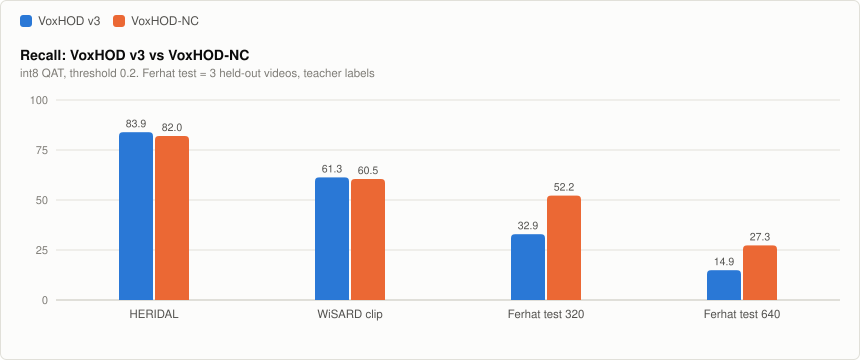
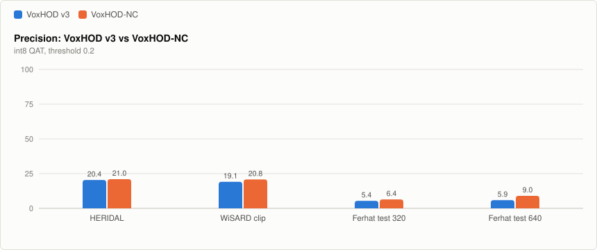

# VoxHOD-NC: drone person detector with extra Turkish footage (non-commercial)

**VoxHOD-NC** is the **non-commercial** branch of
[VoxHOD](https://github.com/ErdemWilkinson/VoxHOD), a tiny int8 person
detector for drone search and rescue on ESP32-S3-class microcontrollers.

> **Türkçe:** VoxHOD-NC, VoxHOD'un ticari olmayan koludur. Ferhat Tatık'ın
> izniyle onun drone görüntüleri eklenerek eğitildi; bu yüzden yalnızca
> ticari olmayan kullanım içindir (CC BY-NC 4.0). Ticari kullanım
> gerekiyorsa, bu görüntüleri hiç görmemiş [VoxHOD](https://github.com/ErdemWilkinson/VoxHOD)
> modelini kullanın (CC BY 4.0). Ferhat Tatık'ın görüntülerinde insan bulma
> oranı v3'e göre belirgin arttı (%32,9 → %52,2), ama yanlış alarm hâlâ çok;
> bu ilk, deneysel sürümdür.

## Which one do I need?

| | [VoxHOD](https://github.com/ErdemWilkinson/VoxHOD) | **VoxHOD-NC** (this repo) |
|---|---|---|
| Training data | HERIDAL only | HERIDAL **plus** drone footage by Ferhat Tatık |
| Model licence | CC BY 4.0, commercial use allowed | **CC BY-NC 4.0, non-commercial only** |
| Status | v3 (197 KB) and nano (75 KB) | **v0, experimental** (197 KB int8, same architecture as v3) |

The footage is used with the photographer's written permission for
non-commercial use. **The footage itself is not published here or anywhere
else**, and its rights stay with Ferhat Tatık.

## v0 (2026-11-03)

How it was made:

1. Frames were taken every 2 s from 14 of Ferhat Tatık's drone videos (plateaus,
   coast, mountains, an enduro race, a marathon, earthquake rescue footage).
2. The videos were **split by video**: 3 held-out test videos (an earthquake
   scene, a lake valley, a city marathon) are never trained on.
3. People were boxed automatically by a large COCO person detector (teacher:
   torchvision Faster R-CNN ResNet50-FPN v2) on every 3rd frame. There was no
   manual review. Only 4 of the 11 training videos are labelled so far
   (559 frames, 2,204 training tiles).
4. Training continued from VoxHOD v3 on HERIDAL + the new tiles (lr 5e-4,
   170 min float, then 50 min quantization-aware training). Confident v3 hits
   far from any teacher person were added as hard negatives.

Results, int8 QAT model, threshold 0.2 (the same fixed threshold as VoxHOD):

| Test set | v3 recall / precision | **NC v0** recall / precision |
|---|---:|---:|
| HERIDAL test | 83.9 / 20.4 | 82.0 / 21.0 |
| WiSARD clip (external) | 61.3 / 19.1 | 60.5 / 20.8 |
| Ferhat test videos, 320 px crops | 32.9 / 5.4 | **52.2 / 6.4** |
| Ferhat test videos, 640 px crops | 14.9 / 5.9 | **27.3 / 9.0** |

<picture>
  <source media="(prefers-color-scheme: dark)" srcset="docs/voxhod-nc-recall-dark.svg">
  
</picture>

<picture>
  <source media="(prefers-color-scheme: dark)" srcset="docs/voxhod-nc-precision-dark.svg">
  
</picture>

What this does and does not show:

- On the new kind of footage, recall rises by about 19 points (320 px) and 12
  points (640 px). On HERIDAL and WiSARD it stays within about 2 points of v3.
- Precision on the new footage is still very low (6-9%), with several false
  alarms per tile. These are mostly oblique, cinematic views with crowds,
  boats and buildings, which are far from the top-down search-and-rescue
  images VoxHOD was built for.
- The Ferhat test labels come from the teacher, not from people. The teacher
  misses some people (swimmers, people under trees), so some "false alarms"
  may be real people, and recall is measured against the teacher's view.
- Tiles whose people are outside 3-64 px on the 160 px tile were left out of
  the Ferhat test, since VoxHOD is not built for that scale.

Next: label the remaining 7 training videos, check a sample of teacher boxes
by hand, and keep the test videos untouched.

## Files

| File | What |
|---|---|
| `weights/voxhod_nc_qat_int8.tflite` | int8, quantization-aware trained (use this one) |
| `weights/voxhod_nc_int8.tflite` | int8, post-training quantization |
| `weights/voxhod_nc.keras` | float Keras model |
| `weights/evaluation_nc.json` | all thresholds, all test sets |
| `weights/evaluation_v3_ferhat_test.json` | v3 on the Ferhat test videos, for comparison |
| `scripts/` | teacher labelling, v3 hard negatives and tile building |

Input and output are the same as VoxHOD v3: a 160x160 RGB tile in, a 40x40
person-centre heatmap plus box size out.

## Code

Training and evaluation code is shared with VoxHOD and lives in
[ErdemWilkinson/VoxHOD](https://github.com/ErdemWilkinson/VoxHOD) (MIT). The
scripts here only build the extra data; they need the footage, which is not
published.

## Thanks

Thanks to **Ferhat Tatık** ([@ferhattatik_dronoloji](https://www.instagram.com/ferhattatik_dronoloji/),
[YouTube @dronoloji](https://www.youtube.com/@dronoloji)) for the drone footage.
@ferhattatik_dronoloji teşekkürler!

## Licence

Model weights: **[CC BY-NC 4.0](https://creativecommons.org/licenses/by-nc/4.0/)**.
See [MODEL_LICENSE.md](MODEL_LICENSE.md). Scripts: MIT, as in VoxHOD.

VoxHOD-NC is built for search and rescue, to help find people who need help.
It is not intended for targeting or harming people.
